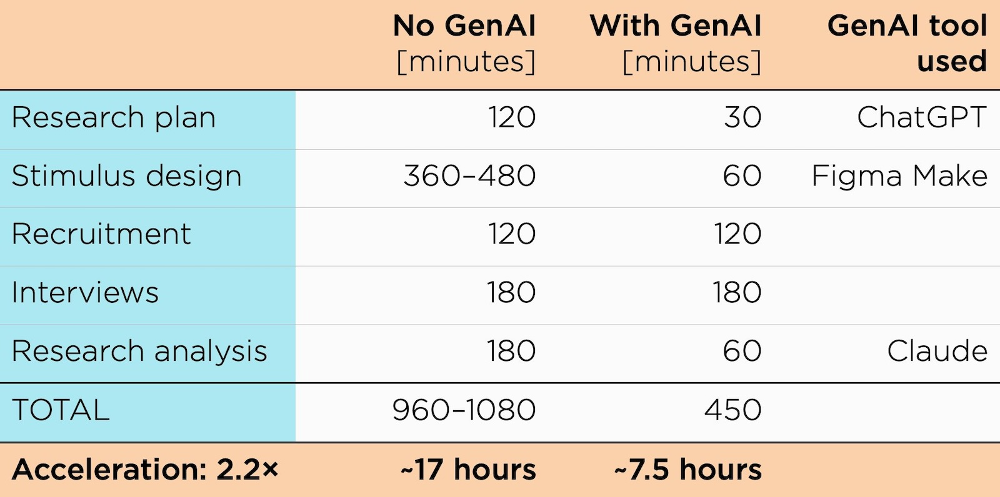

I recently ran a design concept test that normally takes >17h. With GenAI, I cut it down to 7.5h. Here's where I used it, what it helped with, and what I'm still not handing off to AI.

<!--more-->

   

### 1. Research plan
I used ChatGPT to generate the discussion guide in 30min versus >2h manually. The guide generation was instant. I spent most time formulating research objectives in the AI prompt. This part is still hard to delegate to AI, especially on ad-hoc projects where AI needs to be given context about the research goals manually.

There might be a solution though. If we used an AI note-taker during team meetings where we agree research goals, we could hand off those notes as context to GenAI for faster research planning. Could this work? I plan to try this next time.

### 2. Stimulus design
I used Figma Make to prototype a working design stimulus for user testing. After trying Vercel's v0 and Manus, Figma delivered better results with less rework and refinement needed.

With GenAI, I created a sufficient coded prototype in 60min using 10-12 prompts versus 6-8h on manual clickthrough prototyping. Interactive stimulus allows users to input their data and explore non-linear flows, maximising the scope and depth of insight.

But AI-generated prototypes have unique risks. Users viewed bugs as undesired features (‘Was it supposed to delete my data if I click here?’). Testing in working software can also fuel unreasonable expectations (‘It looks like it's working, so why wait so long for release?’), requiring careful assumption management.

### 3. Recruitment and interviews
I haven't used GenAI for recruitment yet. AI-generated messages could help modestly but scheduling is the biggest opportunity area. Traditional recruitment takes at least 2h.

For interviews, I'm more hesitant. While tools exist to scale interviewing, this is the last use case I'd delegate to AI. In complex domains (I work in health-tech) and enterprise settings, face-to-face conversations help surface incidental findings and builds user empathy — these are worth more in the long-run than time savings today. Traditional interviews with 5 users take about 3h.

### 4. Research analysis
I used Claude to analyse interview transcripts and synthesise learnings. I prefer Claude to ChatGPT for more nuanced handling of spoken text. Running interviews myself let me incorporate findings that AI might miss due to conversational ambiguities or body language.

This cut analysis time from 3h to 1h without losing insight quality.

### 5. Conclusions
GenAI tools (ChatGPT, Figma Make, Claude) helped me reduce my 5-user concept testing project from >17h to 7.5h. In my research workflow, GenAI adds most value to stimulus design and research analysis.

I won't delegate interviews to AI yet. I consider time with users not as cost to be slashed but as value creation for the product.

How do you use GenAI to accelerate time to insight?

[Post on LinkedIn](https://www.linkedin.com/posts/marek-kultys_i-used-genai-to-accelerate-time-to-insight-activity-7333522030786437120-JDs3)
